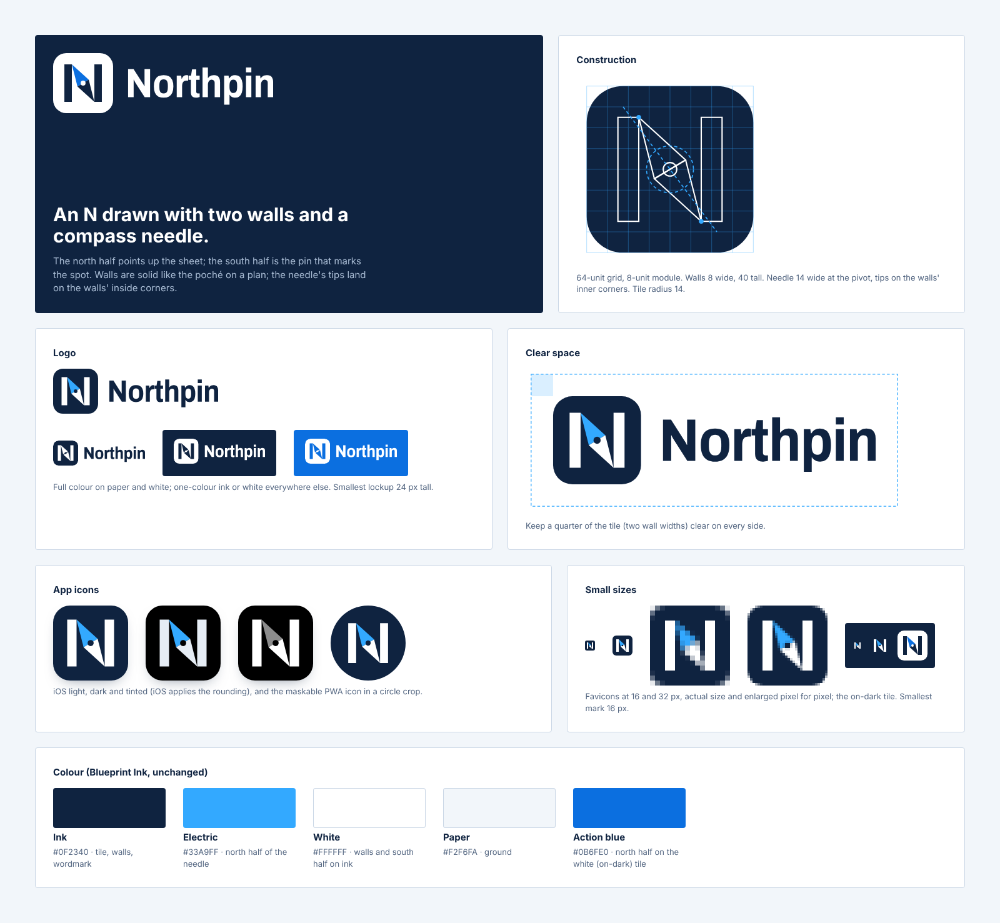

<!-- Palette: Blueprint Ink (chosen Nov 2026): ink navy + electric blue, teal for approved. -->
# Brand and design system

The public site (`/welcome`, `/pricing`, the site footer) and the app both use Blueprint Ink. The site has its own
`.mk` tokens and IBM Plex Sans everywhere; the app maps the same colours onto its Tailwind tokens in
`src/app/globals.css` (see "In the app" below) and keeps Geist for body text.

The product name always comes from `PRODUCT_NAME` in `src/lib/plans.ts`, including the wordmark. Never type it.

## Idea

The site looks like the thing contractors work from: a plan sheet. Ink linework on white drawing paper, device
symbols with letters like a drawing legend, a title block with a scale bar and plan north (drawn with the logo's
needle), and the blue highlighter estimators use to mark what they've counted. One bold thing per page: the plan
lying on the ink "drafting table" (`.mk-table`: ink with a 24px grid and a heavier line every 120px) at the top of
`/welcome` and `/pricing`, running off the table's edge onto the paper below. On `/welcome` it fills in with pins,
its count and the approved quote; everything around it stays quiet.

## Colour

All tokens live under the `.mk` wrapper (`src/components/marketing/marketing.css`). Tailwind utilities
`bg-mk-*`, `text-mk-*`, `border-mk-*` map to them (`@theme inline` in `globals.css`) and do nothing outside `.mk`.

| Token | Hex | Use |
|---|---|---|
| Paper | `#F2F6FA` | Page background. Cool blueprint paper, never cream. |
| Sheet | `#FFFFFF` | Plan sheets, documents, panels that hold product content. |
| Ink (graphite token) | `#0F2340` | Text, linework, the dark band and footer, secondary buttons. Ink navy. |
| Pencil | `#526580` | Secondary text (5.6:1 on paper). |
| Rule | `#C9D6E5` | Hairlines, sheet borders, table rules. Never text. |
| Action blue (marker token) | `#0B6FE0` | Primary action and the final call band. Text on it is always white (4.8:1). |
| Electric | `#33A9FF` | Bright accent on ink: the north half of the logo's needle, step numbers, focus ring on dark (6.2:1 on ink). Never text on white. |
| Highlight | `#CFE6FF` | The takeoff highlighter behind counted figures; ink text on it. |
| Action deep | `#0958B5` | Primary button hover. |
| Redline | `#C73A2C` | Mark-up on photos and plans only. Not for errors or decoration. |
| Approved teal | `#0B7F72` | Approved and paid states (white text 4.9:1). |
| On dark | `#A9BCD4` | Secondary text on ink. |

Device symbol colours are not brand colours: they come from the trade packs (`src/lib/trades.ts`) so the site
shows what the app shows. Trade colours appear only as the 3px rule above each trade in the trades legend and as
the small square beside each trade name under the hero.

In the app (`src/app/globals.css`) the same colours are Tailwind tokens, so existing class names (`bg-brand-600`,
`text-slate-500`, …) pick them up with no renames. Contrast values are checked in `tests/statusStyle.test.ts`.

| App token | Hex | Brand colour / use |
|---|---|---|
| `brand-50` … `brand-300` | `#EEF6FF` `#DDEDFF` `#B9DAFF` `#84BFFF` | Action-blue tints: selected states, `.btn-on`, focus ring on inputs |
| `brand-400` | `#33A9FF` | Electric (logo needle, focus on dark). Not for text on white |
| `brand-500` | `#1A86F0` | Small accents |
| `brand-600` | `#0B6FE0` | Action blue: `.btn-brand`, links, focus outline, input focus border. White text 4.8:1 |
| `brand-700` / `brand-800` | `#0958B5` / `#0A4690` | Action deep (hover), text on blue tints (6.3:1 on brand-50) |
| `ink` | `#0F2340` | `.btn-primary`, page titles, theme colour (14.5:1 on paper) |
| `slate-50` | `#F2F6FA` | Paper: page background |
| `slate-100` … `slate-300` | `#E6EDF5` `#D5DFEB` `#BBC8D8` | Fills, rules, borders. Never text |
| `slate-400` | `#5F718B` | Faint text, icons (5.0:1 on white, 4.6:1 on paper) |
| `slate-500` | `#526580` | Pencil: secondary text, labels, placeholders (6.0:1 white, 5.5:1 paper) |
| `slate-600` … `slate-950` | `#3E506A` … `#08162A` | Body text and dark surfaces (`slate-900` = ink) |
| `ok-*` | 50 `#E7F6F3`, 600 `#0B7F72`, 700 `#096B60` | Approved teal: approved, accepted, paid, installed, answered |
| `info-*` | 50 `#EEF6FF`, 600 `#0B6FE0`, 700 `#0958B5` | Sent, viewed, open |
| `warn-*` | 50 `#FFF6E0`, 600 `#B7791F`, 700 `#7F5300` | Quoting (jobs), ready to send, partly paid, expired, due today |
| `bad-*` | 50 `#FDEEEC`, 600 `#C73A2C`, 700 `#A32D21` | Declined, overdue, errors |

Status chips all come from `src/lib/statusStyle.ts` (`statusChip(status)`): 50 ground, 200 ring, 700 text. Draft and
closed are neutral grey; void is grey and struck through. The jobs map uses `PROJECT_STATUS_HEX` (quoting amber,
approved teal, installed deep teal).

Job stages are shown with `projectStatusLabel()` / `PROJECT_STATUS_LABEL` from the same file: the stored value
`estimate` reads **Quoting**, then Approved and Installed. Never print a raw status value or rely on `capitalize`.

Customer documents (quotes, invoices, PDFs, share pages) use the company's own colours from Settings; when those are
blank or not a hex colour they fall back to `DOC_DEFAULT_BRAND` (ink) and `DOC_DEFAULT_ACCENT` (action blue) in
`src/lib/brandDefaults.ts`. Never hard-code a fallback colour in a component.

Rules: one marker element per view where possible (button or highlighted figure, not both fighting). No gradients,
no tinted washes. Light only for now (`color-scheme: light`); a dark scheme should invert to graphite paper with
white linework and keep marker as the action colour.

## Type

One family: **IBM Plex Sans** (SIL Open Font License; `IBM_Plex_Sans` in `next/font/google`, self-hosted at build
time), variable `wdth` 75–100 and `wght` 100–700, Latin and Cyrillic. Loaded once in
`src/components/marketing/fonts.ts` (`plex`, also exported as `brandFont` for the wordmark) as `--font-mk`, set on
`<html>` in `src/app/layout.tsx`.

- Headlines: Condensed width (`font-stretch: 75%`), weight 700, slight negative tracking. Condensed and heavy like the
  lettering on panels and equipment labels.
- Text and UI: width 100%, weight 400 / 500–600.
- Figures: tabular by default in Plex; `.mk-num` / `.mk-figure` set `tabular-nums` anyway so a later face change
  can't break the columns. No monospace anywhere.
- In the app, Plex (75% width, weight 700, ink) is used only for `.page-title` and the auth pages' wordmark.
  Everything else in the app stays Geist.
- Russian runs about 15% longer than English: `html[lang="ru"] .mk-display` steps the display size down (to 88px at
  most) so the hero's three sentences keep to three lines; other headlines wrap like the English thanks to the
  Condensed width.

| Role | Class | Face, width / weight | Size | Line height |
|---|---|---|---|---|
| Display (h1, the final call) | `.mk-display` | Plex 75 / 700, tracking −0.02em | clamp(48px → 104px); Russian → 88px | 0.93 |
| Section (h2) | `.mk-h2` | Plex 75 / 700 | clamp(34px → 56px) | 0.98 |
| Step / item (h3) | `.mk-h3` | Plex 75 / 600 | clamp(24px → 30px) | 1.05 |
| Lede | `.mk-lede` | Plex 100 / 400, pencil | clamp(17px → 20px) | 1.55, max 36em |
| Body | `.mk-body` | Plex 100 / 400, pencil | 17px | 1.6, max 34em |
| UI / lists | — | Plex 100 / 500–600 | 15px | 1.5 |
| Small / table | — | Plex 100 / 400 | 13–14px | 1.4 |

Sentence case everywhere. No all-caps labels or eyebrows above headings; the only capitals are room names inside
plan drawings, because that's how plans are lettered. Don't colour or italicise one word of a headline.

Why Plex (renders: wordmark lockups and site specimens with a price table and Russian copy): Archivo, the face before
the rebrand, has no Cyrillic on Google Fonts. Plex has full Cyrillic drawn by the same designers as the Latin, and
its Condensed width keeps the lettering-on-equipment voice, with engineering-drawing details (angled terminals on t,
r and the stems) that match the needle's cut. The shortlist lost for these reasons: Golos Text and Onest (excellent
Cyrillic, but rounder and friendlier, generic for a drafting tool, and no width axis for condensed headlines); Sofia
Sans with Sofia Sans Condensed (good widths, but its Cyrillic defaults to Bulgarian letterforms, wrong for Russian
readers); Geist, Inter Tight and Manrope (clean, but the default look of current software); Space Grotesk, Schibsted
Grotesk and Instrument Sans (no Cyrillic).

## Layout and spacing

- Content width 1240px, 16px side gutter on phones, 24px from `sm`.
- Two-column sections use a 5 : 6 split with 64px between, left-aligned; a feature whose drawing is a document and
  a phone side by side takes 4 : 7. Feature sections alternate which side the drawing is on, and the words stay
  in view (`sticky`) while a tall drawing scrolls past. Nothing centred except single buttons on phones.
- Section padding 80px on phones, 96–112px on desktop. Sections are separated by a 1px rule or a change of ground
  (paper → sheet → graphite → marker), not by cards.
- Spacing steps: 4, 8, 12, 16, 20, 24, 32, 48, 64, 80, 112.
- The workflow is numbered because it is a sequence; its five steps hang off one dashed "wire run" (`.mk-steps`:
  across on wide screens, down on phones). Don't number things that aren't steps.
- Trades are shown as a drawing legend: one sheet ruled into cells, each trade under a 3px rule in its pack colour,
  and as a quiet line of trade names under the hero. No customer logos, testimonials or statistics.

## Shape and depth

Radii follow what the object is, not one value for everything:

| Object | Radius |
|---|---|
| Paper (sheets, panels, tables) | 4px |
| Buttons | 10px (8px small) |
| Status pills | full |
| Phone bezel / screen | 30px / 23px |

Paper gets a 1px rule border and a long, soft shadow like a sheet lying on a desk
(`0 18px 40px -24px rgb(28 42 48 / .35)`). Buttons are flat; the primary has a 2px inset bottom edge.

## Components

- `.mk-btn` + `.mk-btn-primary` (marker), `.mk-btn-line` (graphite outline), `.mk-btn-ink` (graphite fill, used on
  the marker band), `.mk-btn-sm`. Labels say what happens ("Start free trial"); no arrows appended.
- `.mk-sheet` paper surface, `.mk-phone` > `.mk-screen` device frame.
- `.mk-hl` highlighter swipe behind a counted figure. Only on counts and totals.
- `.mk-faq` hairline FAQ with a plus that turns to minus.
- `Symbol` / `SymbolMark` (`src/components/marketing/Symbol.tsx`) draw device badges in the trade pack's shape,
  colour and letters.

## Motion

- One orchestrated moment per page: on `/welcome`, pins drop onto the hero plan in sequence, circuits draw, the
  count rises, the quote arrives and the Approved stamp lands (about 3s, once, CSS only).
- Everything else moves only in answer to the person: button press (1px), FAQ open/close, hover colour.
- No scroll-triggered entrances, no parallax.
- `prefers-reduced-motion: reduce` shows the final state with no animation and turns off transitions and smooth
  scrolling.

## Focus and accessibility

- Site: `:focus-visible` is a 3px ink outline, 3px offset; on ink grounds it's electric blue.
- App: every focusable element gets a 2px action-blue outline with 2px offset (`:focus-visible` in `globals.css`);
  inputs draw their own blue ring instead.
- Touch screens (`pointer: coarse`): `.btn` and `.tab` keep their drawn size but get a 44px hit area.
- Pages can always be pinch-zoomed (no `maximum-scale` / `user-scalable=no` in the viewport).
- `prefers-reduced-motion: reduce` turns off the app's entrance animation, button press scale, pulse/ping and
  control transitions.
- AA contrast for all text (checked values above). Device badges are graphics with a text label beside them.
- Drawings are `aria-hidden` with a written `figcaption`/`aria-label` describing what they show.
- Works from 360px wide with no horizontal scroll.

## Logo

The product is being renamed Northpin (northpin.app); the identity below is the Northpin one. Until the rename
lands, `PRODUCT_NAME` still supplies the name shown beside the mark.

`LogoMark` + `Wordmark` in `src/components/marketing/Wordmark.tsx`. The app header (`AppHeader` `Logo`) uses
`LogoMark` + the name; sign-in, sign-up and reset use the `Wordmark` on paper; the footer uses it `onDark`.

- Share card: `src/app/opengraph-image.tsx` renders the 1200 × 630 link preview (Open Graph and Twitter) at build
  time: the on-dark mark and the name on ink, the tagline in on-dark grey, an electric rule, and a corner of a plan
  with lettered devices. It uses the default font (no external font fetch). `SHARE_IMAGE` in
  `src/components/marketing/seo.ts` points every page at it; never use the square app icon as a share image.

## Northpin identity

### Concept

An N drawn the way a plan is drawn. The two uprights are walls, solid like the poché on a floor plan. The diagonal
is a compass needle set to plan north, the arrow every drawing carries: its north half (electric) points up the
sheet, its south half is the pin that marks the spot, and the pivot is the pin's head. It is tilted because plan
north rarely matches the page, and because that is where an N's diagonal goes. Location, north and the drawing in
one letter, with nothing borrowed from map apps.

### Construction

- 64-unit square, 8-unit module. The tile is a continuous-corner square (the iOS icon shape: the curve eases into
  the sides instead of meeting them at a tangent), radius 14.4 (22.5%), the same in the mark, the lockup and the
  icons, so the app icon and the logo match after iOS masks it.
- Walls 8 × 40 units at x 12 and x 44, y 12 to 52. The N is 40 × 40, centred.
- Needle: along the line from the walls' inside corners (20, 12) and (44, 52), 31° from vertical, the angle of an
  N's diagonal. 15.2 units wide at the pivot (32, 32), half-width 7.6 against the walls' 8: wide enough that the
  diamond carries the same weight as the walls (at 7 it read thin, at 8 heavy). The tips run 0.5 past the corners (like a pointed apex in type)
  and the walls are drawn over them, so they touch the corners instead of falling short; nothing pokes out.
- The halves are 0.9 apart (a seam in the tile colour), pivot r 2.4: the pin's head. From 40 px down the seam
  closes; from 24 px down the pivot goes; in the 16 and 32 px favicons neither is drawn.
- One-colour drawings cut the halves 1.8 apart so the needle still reads.
- Wordmark: "Northpin" in IBM Plex Sans Condensed (width 75), weight 700, tracking −10/1000, HarfBuzz kerning plus
  four hand-set pairs (N-o −8, r-t +4, t-h −4, p-i −4), outlined so the logo files need no font. Cap height 30/64 of
  the tile (the walls are 40), baseline 46.5 (half a unit above centre, because the lowercase carries the word),
  15 units from the tile to the N.
- React (`Wordmark`) sets the name live from `PRODUCT_NAME` in Plex Sans at the same width, weight and tracking, sized
  and nudged from `LOCKUP` so caps, baseline and gap match the SVG (checked overlaid: within a pixel at 3×). Pair
  kerning beyond the font's own is only in the outlined files.
- Source of truth: `scripts/brand-icons.mjs` (geometry, colours, pixel maps, every file below, and
  `src/components/marketing/markPaths.ts`, which `Wordmark.tsx` and `opengraph-image.tsx` draw from). Change it
  there and run `node scripts/brand-icons.mjs`; the output is byte-identical on re-run.

### Files

| File | Use |
|---|---|
| `public/brand/northpin-logo.svg` | Horizontal logo, full colour, on paper or white |
| `public/brand/northpin-logo-on-dark.svg` | Full colour on ink: white tile, action-blue north half, white name |
| `public/brand/northpin-logo-mono.svg` / `-white.svg` | One colour, ink or white; the N is cut out of the tile |
| `public/brand/northpin-mark.svg` (+ `-on-dark`, `-mono`, `-white`) | The square mark alone |
| `public/brand/northpin-brand-sheet.png` | This page's overview for the owner |
| `src/components/marketing/markPaths.ts` | Generated paths for `LogoMark`, the share card and the lockup metrics |
| `public/icon.svg`, `favicon.ico` (16, 32, 48), `favicon-16.png`, `favicon-32.png` | Browser tab |
| `public/icon-192.png`, `icon-512.png` | PWA icon (tile, transparent corners) |
| `public/icon-maskable-512.png` | PWA maskable: full-bleed ink, N at 85% (corners at 37.5% radius, inside the 40% safe circle) |
| `public/apple-touch-icon.png` | 180 px, full bleed, no alpha; iOS rounds it |
| `ios/PinPlan/Assets.xcassets/AppIcon.appiconset/*` | 1024 px light, dark (black ground) and tinted (grey levels), no alpha |

Theme colour `#0F2340`, manifest background `#F2F6FA`.

### Favicons

The 16 and 32 px favicons are set by hand as pixel maps in the script, not scaled down: the walls sit on whole
pixels (2 and 4 px wide), the needle is a clean stair, symmetric about the pivot, whose tips touch the walls'
corners, and only its edges use half-strength pixels. Checked on white (`#FFFFFF`), grey (`#DEE1E6`) and dark
(`#202124`) tabs: on dark tabs the ink tile melts into the tab and the white N carries the icon, which is intended.

### Clear space and size

- Keep a quarter of the tile (two wall widths) clear on every side of the mark or the lockup.
- Smallest mark 16 px (favicon). Smallest lockup 24 px tall.

### Colour

Blueprint Ink. Ink tile, white walls and south half, electric (`#33A9FF`) north half. On ink grounds the tile turns
white with ink walls and an action-blue (`#0B6FE0`) north half: electric on white is too faint (2.6:1) and an
electric tile hides the needle. In the 16 and 32 px favicons the north half is `#1A86F0` (brand-500): electric next
to white is only 2.6:1 and the halves smear together at that size; brand-500 keeps 4.5:1 on ink and parts from the
white. The iOS dark icon uses off-white walls (`#E6EDF5`) on black; the tinted icon is grey levels with a mid-grey
north half so the tint still shows two halves.

### Do

- Use the files or `LogoMark` / `Wordmark` as they are; pick the on-dark or one-colour version for the ground.
- Keep the needle two-toned (or cut, in one colour). It is what makes the N a Northpin.

### Don't

- Don't straighten, flip or recolour the needle, or point it anywhere else.
- Don't put the mark on a gradient, add shadows or outlines, or set the tile on a ground of the same colour.
- Don't redraw the wordmark in another face, add a tagline inside the lockup, or stack the name under the mark.
- Don't use the mark as a map pin or a device symbol in the plan; devices keep their trade letters and colours.

## Voice

- Write like a foreman explaining the tool to another contractor: plain verbs, short sentences, the trade's own
  words (plans, floors, devices, wire runs, panel, rough-in, punch list).
- Use the app's glossary (`docs/ux-audit.md`): job, plan/floor, device, wire run, count (takeoff), quote, approve,
  invoice, price list, technician / office.
- Say what it does, not how good it is. No testimonials, logos, statistics or "trusted by" claims unless they are
  real and sourced.
- Only claim what ships. AI features are off: don't mention them. Billdu is an optional connected app, not a feature.
- Example content (job names, people, prices) is clearly sample data and comes from the trade packs' starting prices.
